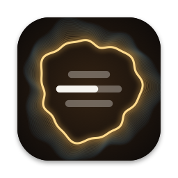

<p align="center"></p>

<h1 align="center">Desk Music Companion</h1>

<p align="center">Turn a spare iPhone into a little display that sits on your desk and follows whatever your Mac is playing.</p>

Play a song in Apple Music, Spotify, or a YouTube tab in Safari, and the phone shows the album art and the lyrics in time with the music. Songs in Hindi, Tamil and other scripts get an English-letters version and an English translation. There's also a visualizer the lyrics are part of, and a tab of tidbits about the song, film or artist.

## What you get

| Tab | What it shows |
|---|---|
| **Lyrics** | The words scroll above; the current line's transliteration and English stay put below. In landscape the two sit side by side. |
| **Visualizer** | A full-screen picture in the album's colours. Words give off light as they're sung, a ring reacts to the music, and touching the screen ripples and stirs it. |
| **Tidbits** | Facts and a few jokes about the song, album, film and artist, with a loading bar the first time. |

Double-tap anywhere for controls: play/pause, next, previous, show or hide the transliteration and English, and nudge the lyric timing.

## How it works

You need both devices, and they do different jobs.

```
Mac                                                        iPhone on the desk
├─ knows what's playing   (media-control, Safari tabs)     └─ full-screen app that
├─ hears the sound        (visualizer/audio_levels)           shows the page and
├─ finds the lyrics       (LRCLIB)                            keeps the screen on
├─ translates, researches (Google, Wikipedia, Ollama)
└─ serves it all on port 8787  ───── your Wi-Fi ─────►
```

The Mac runs `server.py`, which starts by itself at login. A small helper in the menu bar shows what's playing and can start or stop the server. The iPhone app is only a window onto the page the Mac serves, so nearly all the work happens in `server.py` and `index.html`.

## Set it up

### 1. On the Mac

You need macOS 14.2 or later, [Homebrew](https://brew.sh), and the Xcode command line tools (`xcode-select --install`).

```bash
git clone https://github.com/pr4peace/desk-music-companion.git
```

```bash
cd desk-music-companion
```

```bash
./install.sh
```

That builds the helpers, starts the server now and at every login, and puts a ring icon in your menu bar. It prints the address your phone needs.

macOS will ask for a few permissions the first time each is needed:

- **System Audio Recording** lets the visualizer hear the music. Nothing is recorded or saved.
- **Automation for Safari** lets it read YouTube tabs.
- For YouTube timing, also turn on **Allow JavaScript from Apple Events** in Safari's Developer settings.

### 2. On the iPhone

1. Open `ios/DeskLyrics.xcodeproj` in Xcode.
2. Under **Signing & Capabilities**, choose your own Team and change the Bundle Identifier to something of your own.
3. Plug in the phone, pick it as the destination, and press Run.
4. The app will say it can't reach your Mac. Type in the address from `install.sh` and tap Connect.

Keep the phone on the same Wi-Fi as the Mac. With a free Apple account the app stops opening after 7 days until you run it from Xcode again.

No Xcode? Open the address in Safari on the phone. Everything works except keeping the screen awake.

### 3. Optional: better tidbits

Tidbits work without this, but the funny ones need a model running on your own Mac through [Ollama](https://ollama.com):

```bash
ollama pull qwen3.5:9b
```

`WRITERS` in `server.py` lists which models it will use, best first.

## Working on it

| Where | What's in it |
|---|---|
| `server.py` | Now-playing detection, lyrics, transliteration, translation, tidbits, and the web server. Python standard library only. |
| `index.html` | The whole phone interface, in one file: layout, tabs, lyric animation, and the WebGL visualizer. |
| `visualizer/` | Swift helper that measures the Mac's audio output. |
| `mac/` | The menu bar helper and its icon. |
| `ios/` | The iPhone app. |
| `assets/make_icons.swift` | Draws every icon from code. Run it from the project folder to regenerate them. |
| `install.sh` | Mac setup. Safe to run again. |
| `tools/check_sync.py` | Compares the lyric timing with the voice the Mac hears right now. Prints no lyrics. |

After changing `index.html`, just reload the page. After changing `server.py`, choose **Restart Server** from the menu bar. Problems are logged to `~/Library/Logs/DeskLyrics.log`.

To test the phone layout without a phone, run the app in the iOS Simulator; it reaches the Mac at `http://127.0.0.1:8787`.

Please work on a branch and open a pull request.

### A few house rules

- **No lyrics beats wrong lyrics.** If we can't be sure a record is the right song, show nothing.
- **Never commit `cache/`, and don't paste lyrics into issues or code.** Lyrics are copyrighted. `.gitignore` already covers the cache.
- **Tidbits only say what the articles say.** Any tidbit naming a person or number that isn't in the source gets dropped. Keep that check.
- **Keep the server dependency-free.** The standard library has been enough so far.

### Good first things to work on

- Spotify hasn't been tested end to end.
- Next and previous haven't been tested on real YouTube playback.
- Word-by-word highlighting is an estimate, because lyric sites only time whole lines.
- Have the iPhone find the Mac by itself on the network instead of typing an address.
- Use Apple's on-device model for tidbits when Ollama isn't installed.
- Make the funny tidbits funnier.

## What leaves your Mac

| Service | What it receives | Why |
|---|---|---|
| [LRCLIB](https://lrclib.net) | Song title, artist, album, length | Lyrics |
| Google Translate and Input Tools (unofficial endpoints) | Lines of the lyrics | Translation |
| Wikipedia | Song, album and artist names | Tidbits |
| YouTube's image server | Video ID | Thumbnails |

Audio never leaves the Mac and is never saved. Ollama runs locally. The server listens on your local network with no password, so only run it on a network you trust.
