<p align="center"></p>

<h1 align="center">Desk Music Companion</h1>

<p align="center">Turn a spare iPhone into a little display that sits on your desk and follows whatever your Mac is playing.</p>

Play a song in Apple Music, Spotify, or a YouTube tab in Safari, and the phone shows the album art and the lyrics in time with the music. Songs in Hindi, Tamil and other scripts get an English-letters version and an English translation. There's also a visualizer the lyrics are part of, and a tab of tidbits about the song, film or artist.

## See it

<table>
  <tr>
    <td width="33%">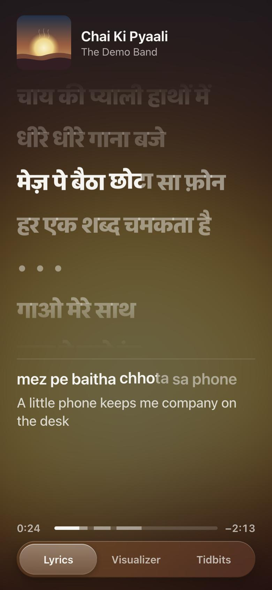</td>
    <td width="33%">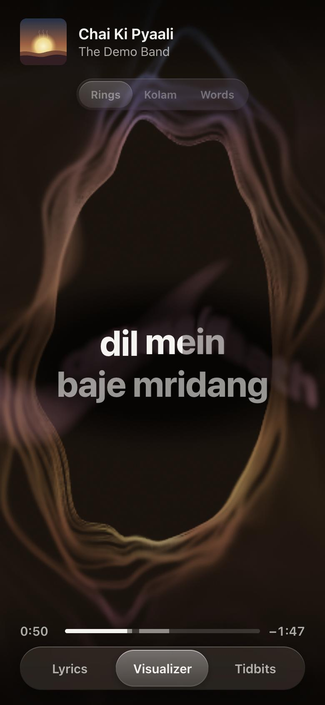</td>
    <td width="33%">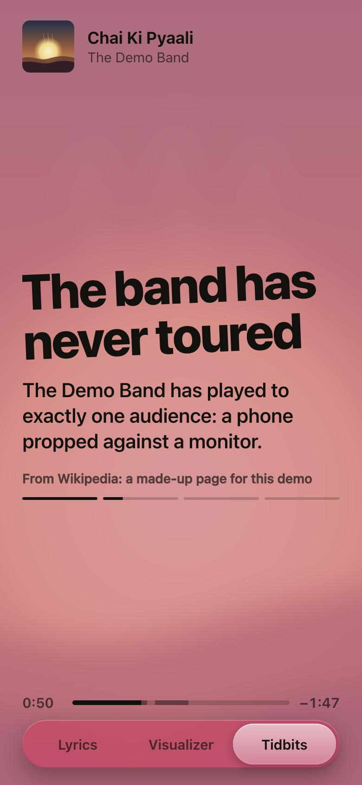</td>
  </tr>
  <tr>
    <td><b>Lyrics.</b> Each word lights up as it's sung. Below, the same line in English letters and what it means.</td>
    <td><b>Visualizer.</b> The song in the album's colours, with the line being sung in the middle.</td>
    <td><b>Tidbits.</b> Facts and the odd joke about the song, as posters in its colours.</td>
  </tr>
</table>

<sub>All screenshots use a made-up song, written for this README, so no one's real lyrics or album art appear here. Run <code>python3 tools/demo_server.py</code> to see it yourself.</sub>

### A few ways to use it

**Sing along to a song in a language you can't read.** A Hindi or Tamil song plays, and you can't read the script. Turn on **In English letters** and sing from the line under the lyrics. Pick **English: Natural** to see what it means, written the way a person would say it, or **Literal** for word for word.

**Learn a language through its songs.** Keep all three on: the script above, how it sounds below, and what it means under that. Line by line you start to match the letters to the sounds and the sounds to the words.

**Catch what a translation can't carry.** With **What it means** on, lines that hold more than their words get a short note under the English: the idiom, what a metaphor stands for, a cultural or religious reference, a double meaning, or how a line answers an earlier one. The Mac writes the notes with the whole song in view, and plain lines get none. A ring under the lyric fills as the translation and notes are written.

<table>
  <tr>
    <td width="33%">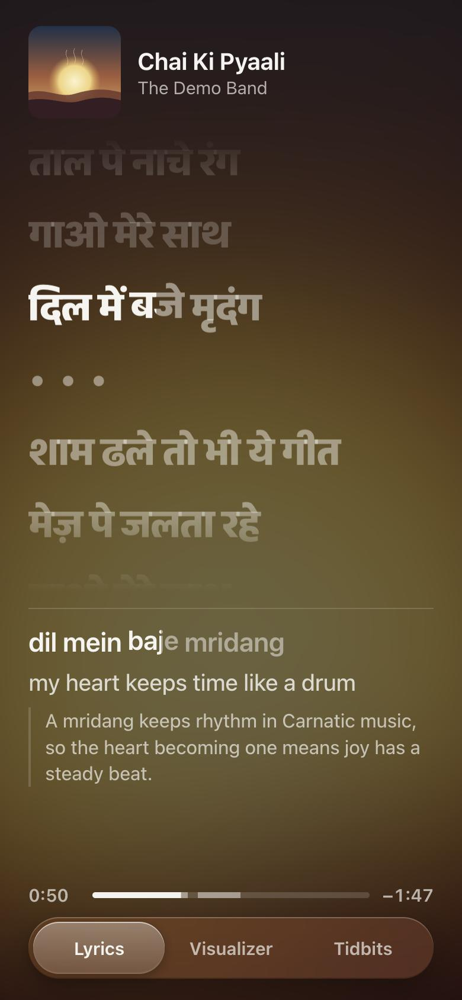</td>
    <td width="33%">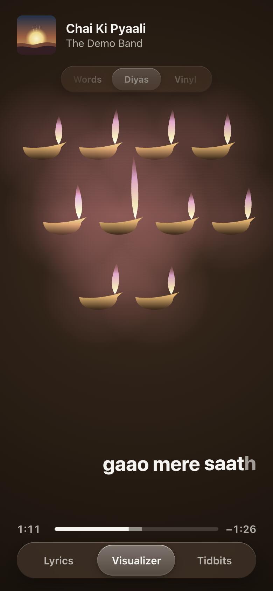</td>
    <td width="33%">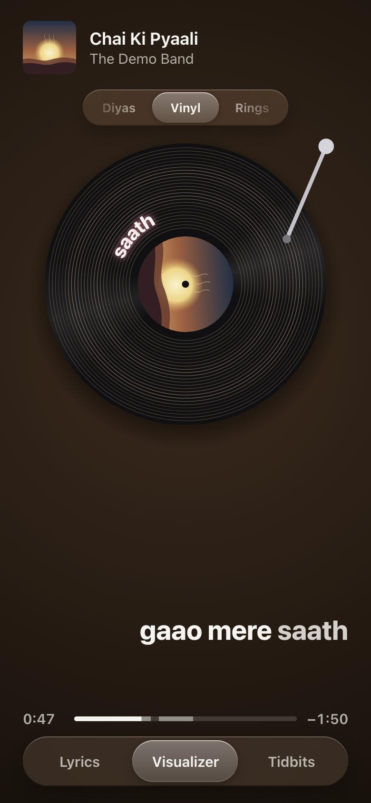</td>
  </tr>
  <tr>
    <td><b>What it means.</b> A note on the line, from the song as a whole.</td>
    <td><b>Diyas.</b> A lamp lights for each new line and stays lit, so the song fills the screen with light. A chorus makes them all flare.</td>
    <td><b>Vinyl.</b> The cover spins as the label, the grooves light with the music, and the tone arm moves in as the song plays.</td>
  </tr>
</table>

**Something good to look at while you work.** Switch to the Visualizer and leave it be. After a few seconds without a touch the tabs fade away and the title dims, so only the music and the words are lit.

<table>
  <tr>
    <td width="33%">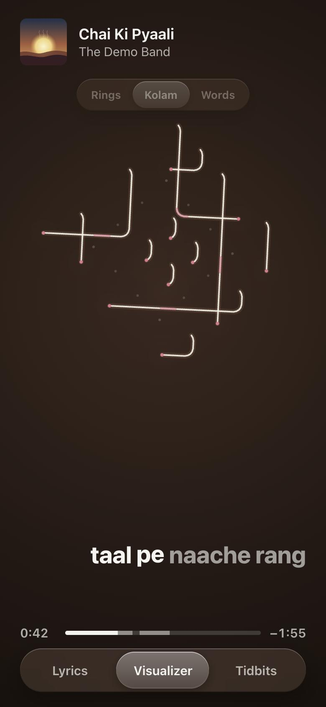</td>
    <td width="33%">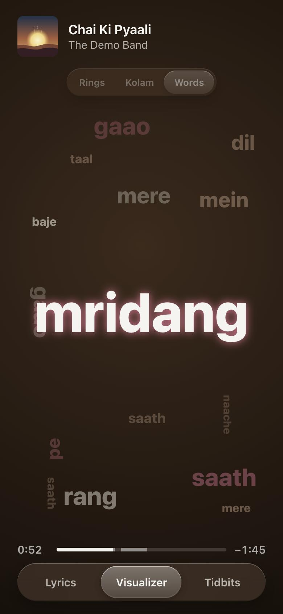</td>
    <td width="33%">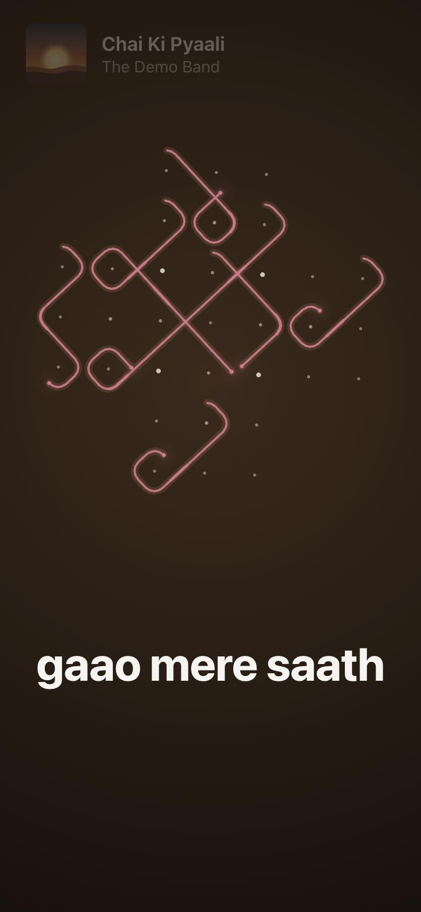</td>
  </tr>
  <tr>
    <td><b>Kolam.</b> Each verse draws its own kolam. Beats ripple through the dots and light runs along the lines.</td>
    <td><b>Words.</b> Each word lands big, then settles somewhere, until the song becomes a poster of itself.</td>
    <td><b>Left alone.</b> After 8 seconds the tabs fade and the title dims. Touch the screen to bring them back.</td>
  </tr>
</table>

**Find out about the song while it plays.** Open Tidbits for facts about the song, the film it's from and the people who made it. They're researched in the background, so they're usually ready by the time you look. Swipe sideways to flip through them.

**Control the music without reaching for the Mac.** Double-tap anywhere for play, pause, next and previous. Tap anywhere outside to put the controls away.

**Fix lyrics that run early or late.** In the controls, **−** and **+** move the lyrics a quarter second at a time, and the label tells you where they are: "Lyrics 0.5 s earlier". Tap the label to put them back on time.

<table>
  <tr>
    <td width="33%">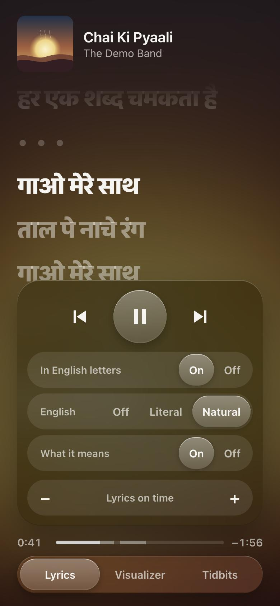</td>
    <td width="33%">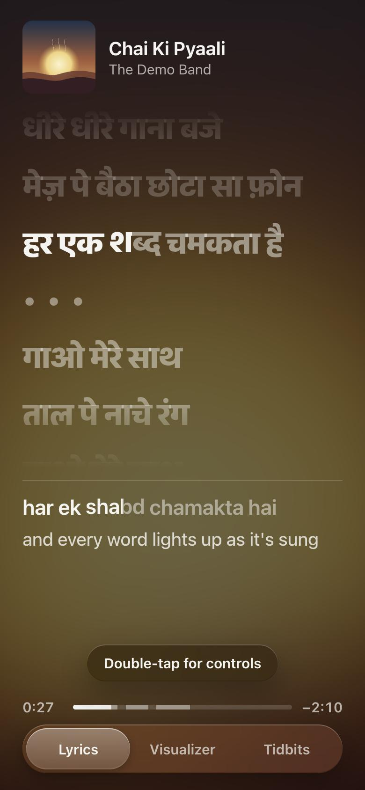</td>
    <td width="33%">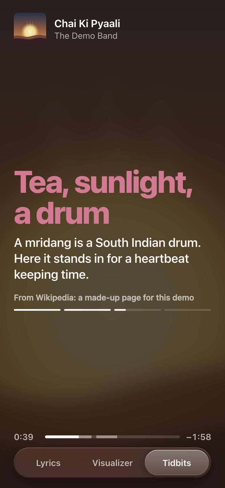</td>
  </tr>
  <tr>
    <td><b>Controls.</b> Only what applies to the tab you're on.</td>
    <td><b>Hints.</b> The first few times, a hint shows the gesture. It stops once you've used it.</td>
    <td><b>More tidbits.</b> Each card takes the album's colours, light or dark.</td>
  </tr>
</table>

**Lying on its side.** Turn the phone sideways and the lyrics and their English letters and meaning sit side by side.

<p>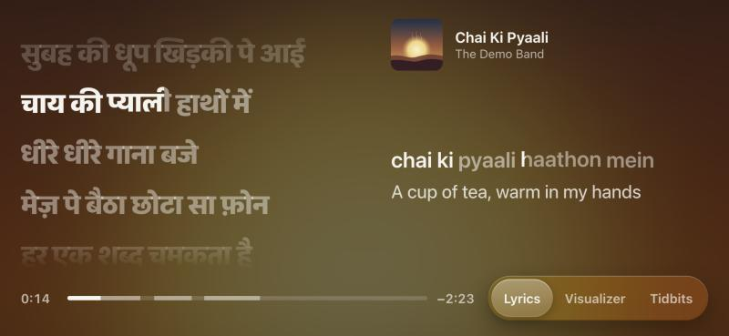</p>

## What you get

| Tab | What it shows |
|---|---|
| **Lyrics** | The words scroll above; the current line's transliteration and English stay put below. In landscape the two sit side by side. English can be word for word or written for meaning. |
| **Visualizer** | Five styles; swipe sideways to switch, and the row goes round. **Rings**: a full-screen picture in the album's colours, where the sung words give off light, a ring reacts to the music, and touch ripples and stirs it. **Kolam**: each verse draws its own South Indian kolam around a grid of dots, with beats rippling through the dots and light racing along the lines. **Words**: no lines of text, just each sung word landing big and then settling somewhere on the screen, so the song builds up into a poster of itself. Kolam patterns vary in shape, size, line and dot style, and are drawn fresh each time a song plays. **Diyas**: a clay oil lamp lights for each new line and stays lit, the line being sung burns tallest, and a returning chorus makes them all flare. **Vinyl**: the album cover spins as a record's label, the grooves light up with the music, the sung word circles the label, and the tone arm moves in across the record as the song plays. |
| **Tidbits** | Full-screen poster cards in the album's colours with facts and a few jokes about this song, from Wikipedia. They're researched in the background once a song has played about 20 seconds, so they're usually ready when you open the tab. |

## How to use

Leave the phone on the desk with the app open and play music on the Mac. Everything follows along by itself: the song, the art, the lyrics and the colours.

- **Switch views** with the tabs at the bottom: Lyrics, Visualizer and Tidbits.
- **Double-tap anywhere for controls.** Tap anywhere outside them, or double-tap again, to put them away; they also go on their own after a few seconds. They only show what applies to the tab you're on:
  - **Every tab:** previous, play/pause, next.
  - **Lyrics:** **In English letters** turns the transliteration on or off. **English** picks **Off**, **Literal** (word for word) or **Natural** (written for meaning). **What it means** adds a short note under lines whose meaning needs more than a translation. The first time Natural and the notes run on a song they take 20 to 50 seconds each, with a filling ring under the lyric to show how far along they are; the literal English shows meanwhile. **− / +** moves the lyrics a quarter second earlier or later if they drift, and the label says where they are; tap it to put them back on time. It's remembered for that song.
  - **Visualizer:** playback, and the timing nudge for the sung line.
- **With VoiceOver,** double-tap belongs to VoiceOver, so swipe to the **Show controls** button just after the song title instead. With a keyboard, Tab gets you there and Escape closes the controls.
- **Left alone,** after 8 seconds the tabs and progress bar fade and the title dims. Any touch, a new song or a pause brings them back.
- **Visualizer styles:** swipe sideways to switch between **Rings**, **Kolam**, **Words**, **Diyas** and **Vinyl**. The glass pill at the top shows the one that's on with its neighbours either side, and slides along as you swipe; past the last style it comes back round to the first. You can tap the neighbours too. In Rings, touching the screen ripples and stirs the picture. In Kolam, it lights up the dots under your finger.
- **Progress bar:** the brighter stretches are where the singing is, with elapsed and remaining time on either side.
- **Tidbits:** they're researched in the background about 20 seconds into each song. If you open the tab sooner, a loading bar shows the progress. Cards rotate on their own; swipe sideways to flip through them.
- **Mac menu bar:** the ring icon shows what's playing and the phone's address, and can start, stop or restart the server.
- **Lyrics feel off?** On the Mac, run `python3 tools/check_sync.py` during a sung part. It says whether the lyrics are in sync, early or late, or the wrong version.

## How it works

You need both devices, and they do different jobs.

```
Mac                                                        iPhone on the desk
├─ knows what's playing   (media-control, Safari tabs)     └─ full-screen app that
├─ hears the sound        (visualizer/audio_levels)           shows the page and
├─ finds the lyrics       (LRCLIB)                            keeps the screen on
├─ translates, researches (Google, Wikipedia, Ollama)
└─ serves it all on port 8787  ───── your Wi-Fi ─────►
```

The Mac runs `server.py`, which starts by itself at login. A small helper in the menu bar shows what's playing and can start or stop the server. The phone simply opens the page the Mac serves, saved to its Home Screen, so all the work happens in `server.py` and `index.html`.

## Set it up

> **On Windows?** Not yet. The computer side currently needs a Mac, because it reads what's playing, hears the audio and transliterates using parts of macOS. Everything on the phone works the same with a PC, and [ROADMAP.md](ROADMAP.md#windows-support) lists the Windows replacement for each Mac-only piece, if you'd like to build it.

### 1. On the Mac

You need macOS 14.2 or later, [Homebrew](https://brew.sh), and the Xcode command line tools (`xcode-select --install`).

```bash
git clone https://github.com/pr4peace/desk-music-companion.git
```

```bash
cd desk-music-companion
```

```bash
./install.sh
```

That builds the helpers, starts the server now and at every login, and puts a ring icon in your menu bar. It prints the address your phone needs.

macOS will ask for a few permissions the first time each is needed:

- **System Audio Recording** lets the visualizer hear the music. Nothing is recorded or saved.
- **Automation for Safari** lets it read YouTube tabs.
- For YouTube timing, also turn on **Allow JavaScript from Apple Events** in Safari's Developer settings.

### 2. On the iPhone

There's no app to install. The phone opens the page the Mac serves and keeps it on the Home Screen, so there's nothing to build, sign or renew.

1. On the iPhone, open Safari and go to the address from `install.sh`, for example `http://Your-Mac.local:8787`.
2. Tap Share, then **Add to Home Screen**. It gets its own icon and opens full screen, like an app.
3. In Settings → Display & Brightness, set **Auto-Lock** to **Never**, so the screen stays on. (Web pages can only keep the screen awake on their own over HTTPS, and this one is plain HTTP on your Wi-Fi.)
4. Optional: Settings → Accessibility → **Guided Access** locks the phone to this one screen. Triple-click the side button to start or stop it.

Keep the phone on the same Wi-Fi as the Mac. Any phone or tablet with a browser works the same way.

### 3. Optional: translate on your Mac

```bash
translate/setup.sh
```

This installs translation models that run on your Mac, so songs written in Indian scripts are translated here in about 10 to 15 seconds, with no limits and nothing sent out:

- **IndicTrans2** from AI4Bharat, built for Indian languages, handles Tamil, Telugu, Malayalam, Kannada, Punjabi and the rest. It needs a free Hugging Face account: accept the terms on [its page](https://huggingface.co/ai4bharat/indictrans2-indic-en-dist-200M), run `translate/.venv/bin/hf auth login`, then run `setup.sh` again.
- **NLLB** from Meta handles Hindi and Urdu, where it did better in a blind test, and stands in for IndicTrans2 if you skip the login. Its license allows only non-commercial use.

Together they take about 4 GB. Without them, Google translates, and when Google says "too many requests", the local model below takes over.

### 4. Optional: a local model

Tidbits work without this, but the funny ones, and the **Natural** translation option (English that says what each line means instead of word for word), need a model running on your own Mac through [Ollama](https://ollama.com):

```bash
ollama pull qwen3.5:9b
```

`WRITERS` in `server.py` lists which models it will use, best first.

## Working on it

| Where | What's in it |
|---|---|
| `server.py` | Now-playing detection, lyrics, transliteration, translation, tidbits, and the web server. Python standard library only. |
| `index.html` | The whole phone interface, in one file: layout, tabs, lyric animation, and the WebGL visualizer. |
| `visualizer/` | Swift helper that measures the Mac's audio output. |
| `mac/` | The menu bar helper and its icon. |
| `assets/make_icons.swift` | Draws every icon from code. Run it from the project folder to regenerate them. |
| `install.sh` | Mac setup. Safe to run again. |
| `translate/` | The optional on-Mac translators: `setup.sh` installs them, and the server runs `indictrans.py` or `nllb.py` depending on the language. |
| `tools/check_sync.py` | Compares the lyric timing with the voice the Mac hears right now. Prints no lyrics. |
| `tools/demo_server.py` | Serves the page with a made-up song, for working on the interface or taking screenshots. |
| `docs/screenshots/` | The README's screenshots, all of the demo song. |

After changing `index.html`, just reload the page. After changing `server.py`, choose **Restart Server** from the menu bar. Problems are logged to `~/Library/Logs/DeskLyrics.log`.

To test the phone layout without a phone, open `http://127.0.0.1:8787` in Safari in the iOS Simulator.

To work on the interface without music playing, run `python3 tools/demo_server.py` and open `http://localhost:8790`. It plays a made-up song with its own words, translations, cover, tidbits and audio levels; `/demo/seek?t=42` jumps to 42 seconds. It's what the screenshots above were taken with.

Please work on a branch and open a pull request.

### A few house rules

- **No lyrics beats wrong lyrics.** If we can't be sure a record is the right song, show nothing.
- **Never commit `cache/`, and don't paste lyrics into issues or code.** Lyrics are copyrighted. `.gitignore` already covers the cache.
- **Tidbits only say what the articles say.** Any tidbit naming a person or number that isn't in the source gets dropped. Keep that check.
- **Keep the server dependency-free.** The standard library has been enough so far.

### Good first things to work on

[ROADMAP.md](ROADMAP.md) has the bigger plans, including Windows support. Smaller things:

- Spotify hasn't been tested end to end.
- Next and previous haven't been tested on real YouTube playback.
- Word-by-word highlighting is an estimate, because lyric sites only time whole lines.
- Have the iPhone find the Mac by itself on the network instead of typing an address.
- Use Apple's on-device model for tidbits when Ollama isn't installed.
- Make the funny tidbits funnier.

## What leaves your Mac

| Service | What it receives | Why |
|---|---|---|
| [LRCLIB](https://lrclib.net) | Song title, artist, album, length | Lyrics |
| Google Translate and Input Tools (unofficial endpoints) | Lines of the lyrics | Translation, unless the on-Mac translators are installed and the song is in an Indian script |
| Wikipedia | Song, album and artist names | Tidbits |
| YouTube's image server | Video ID | Thumbnails |

Audio never leaves the Mac and is never saved. Ollama runs locally. The server listens on your local network with no password, so only run it on a network you trust.
